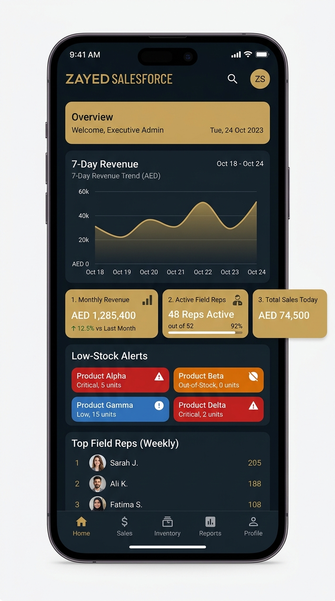
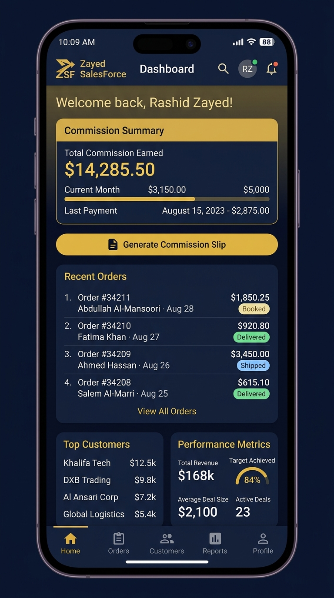
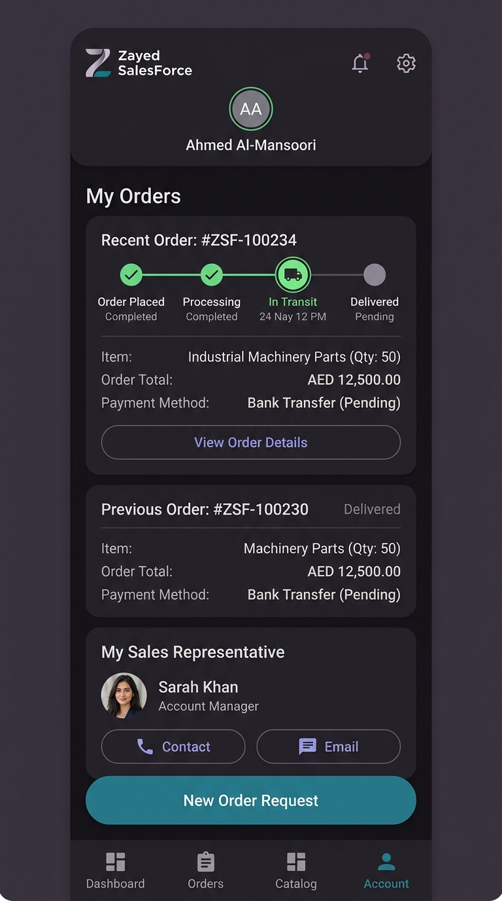
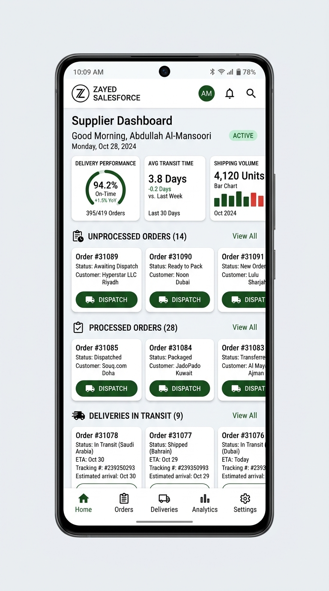

# Zayed SalesForce

Enterprise Sales, Inventory, Commission & Delivery Management System.

Zayed SalesForce is a high-performance Android application built with Kotlin and Jetpack Compose, designed to streamline route-to-market operations for modern enterprises. It provides a robust, multi-role ecosystem for Administrators, Sales Representatives, Customers, and Suppliers.

## 🚀 Key Features

- **Multi-Role Dashboards**: Specialized landing pages for Admin, Staff, Customers, and Suppliers with real-time KPIs and analytics.
- **3-Layer Stock Alert System**: Advanced inventory monitoring classifying stock warnings into **Low**, **Critical**, and **Out-of-Stock** categories.
- **Dynamic Commission Calculator**: Supports both flat fixed fees and percentage-based commission structures for individual sales reps.
- **Branded Commission Slips**: Generate professional, downloadable commission summaries for representatives.
- **Real-Time Order Tracking**: End-to-end visibility for customers from order placement to final delivery.
- **Advanced Security**: Biometric authentication (Fingerprint/Face Unlock) integrated with a PIN-based secondary authorization layer.
- **Cloud Synchronization**: Ultra-fast synchronization with Supabase using GZIP compression to minimize bandwidth usage.
- **Automated WorkManager**: Background sync tasks with battery-saving constraints to ensure minimal resource footprint.

---

## 📸 Dashboard Screenshots

### 1. Executive Admin Dashboard
Manage the entire system with high-level KPIs, 7-day revenue reports, and automated inventory alerts.

### 2. Sales Representative Dashboard
Track your sales pipeline, view earned commissions, and generate official commission slips.

### 3. Customer Account Portal
Track order status in real-time, view pricing, and contact assigned representatives.

### 4. Supplier Logistics Hub
Manage unprocessed orders, track transit status, and optimize delivery performance.

---

## 🛠 Tech Stack

- **UI**: Jetpack Compose (Material 3)
- **Database**: Room (Local Persistence)
- **Backend**: Supabase (Cloud Sync & Auth)
- **Background Tasks**: WorkManager
- **Graphics**: Vico Charts
- **Authentication**: Android Biometric Library & Jetpack Credential Manager
- **Reporting**: Android PDF Printer (PDF Generator)

## 📦 Resource Optimization

- **Lightweight**: Optimized APK size under 5MB.
- **Efficient Sync**: Less than 1MB per sync cycle using GZIP payload compression.
- **Power Aware**: Sync tasks respect battery levels to prolong device life.
